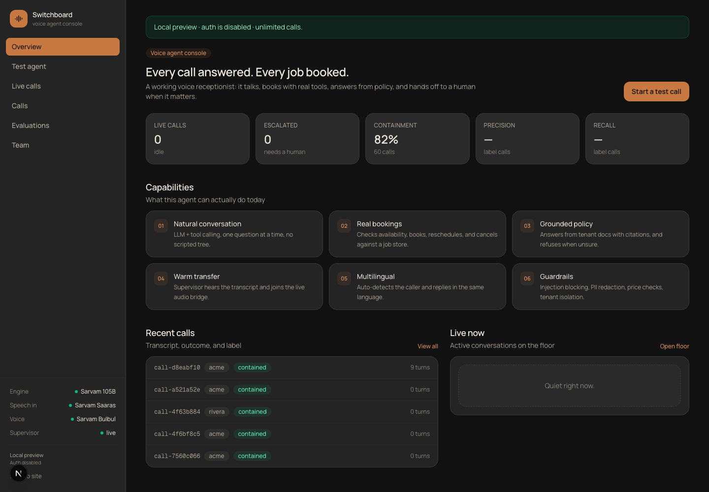
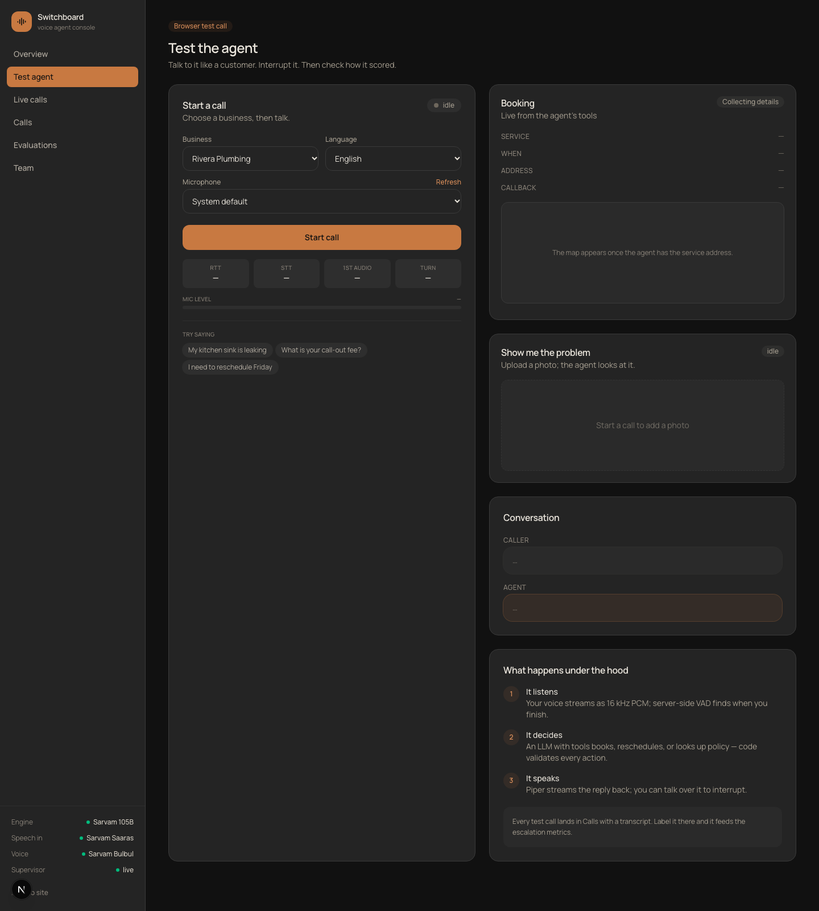
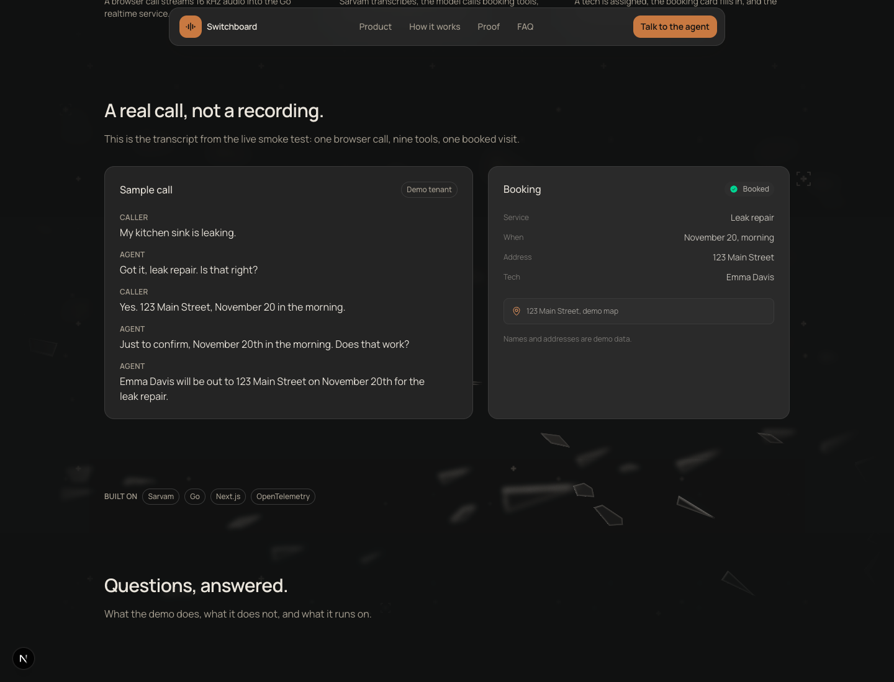
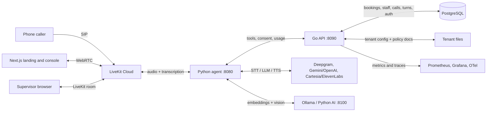

# Switchboard

[](https://github.com/chinmayyy01/switchboard/actions/workflows/ci.yml)

**An AI voice receptionist for home services.**

Switchboard handles browser-based voice calls, books visits against its own staff schedule, answers policy questions from tenant documents, and hands the call to a supervisor with the full transcript. It runs on a Go realtime service, a Python AI service, a Next.js console, and configurable speech and language models.


> **Status:** portfolio demo with a phone-ready agent path.
> Browser and LiveKit SIP calls are supported. No public number is provisioned in this snapshot.
> Auth is enabled by default; accounts and sessions live in PostgreSQL.
> Bookings, staff, calls, transcript turns, labels, recording metadata, and usage live in PostgreSQL.
> Recording requires `RECORDING_S3_*`; without it the agent tells the caller recording is unavailable.
> A real number still needs carrier KYC and the reviewed LiveKit SIP plans in `docs/telephony.md`.
> Production hardening is tracked in `docs/production-phases.md`.

## Contents

- [What it does](#what-it-does)
- [Case study](docs/case-study.md)
- [Screenshots](#screenshots)
- [Quick start](#quick-start)
- [Architecture](#architecture)
- [LiveKit agent and telephony](docs/telephony.md)
- [Measurements](#measurements)
- [Configuration](#configuration)
- [Commands](#commands)
- [Project layout](#project-layout)
- [Limitations](#limitations)
- [Production readiness](#production-readiness)
- [Deployment](deploy/README.md)
- [Credits](#credits)

## What it does

- **Natural voice calls.** LiveKit media, Deepgram streaming STT, Gemini or OpenAI for the reply, Cartesia or ElevenLabs for TTS, with barge-in and a semantic turn detector.
- **Durable demo bookings.** The agent checks staff availability, assigns a qualified technician, and stores the visit in PostgreSQL. It is not connected to an external calendar or field-service system.
- **Alternatives when full.** If no technician is available, the tool returns specific dates and windows and the agent asks the caller to choose.
- **Grounded policy.** Hours, pricing, warranty, and service area are answered from tenant documents with citations; it refuses when the answer is not grounded.
- **Warm handoff.** Emergencies and human requests transfer to the manager or hand the LiveKit room to a signed-in supervisor with the transcript.
- **Photo triage.** A caller can upload a photo; local vision writes a description into the same LiveKit conversation.
- **Consent and retention.** Audio recording and transcript storage are separate, versioned choices. Audio is deleted after 30 days and transcript turns after 180 by default.
- **Tenant aware.** Services, docs, staff, and the console are separated per tenant.
- **Budget aware.** A per-tenant usage ledger and price table feed a pre-call budget check and a hard call duration.

## Screenshots

### Landing


### Console



### Test call



### Measured call



## Quick start

### Requirements

- Go 1.26+
- Node.js 20+
- Python 3.12 (the agent needs 3.12 or 3.13)
- Ollama
- PostgreSQL 16+ or Docker for the local database
- Redis (optional locally, required for multiple Go instances)
- Make
- LiveKit Cloud project and API keys
- Deepgram key (STT)
- Gemini or OpenAI key (LLM)
- Cartesia or ElevenLabs key (TTS)

### 1. Environment

```bash
cp .env.example .env
```

Set at least:

```bash
LIVEKIT_URL=wss://your-project.livekit.cloud
LIVEKIT_API_KEY=...
LIVEKIT_API_SECRET=...
DEEPGRAM_API_KEY=...
GEMINI_API_KEY=...          # or OPENAI_API_KEY
CARTESIA_API_KEY=...        # or ELEVEN_API_KEY
AGENT_API_KEY=...
AGENT_TOKEN_SECRET=...      # must differ from AGENT_API_KEY
```

`AUTH_DRIVER=postgres` is the default. Create the owner before signing in:

```bash
go run ./cmd/account -owner -email you@example.com -password '...' -tenant rivera
```

The browser console uses LiveKit. The Python AI service is still needed for
policy retrieval and vision, and Ollama supplies embeddings. Local Whisper/Piper
are a fallback for the legacy inference path, not the LiveKit agent.

### 2. Start PostgreSQL and Redis

The local compose file creates a development database matching `DATABASE_URL`
in `.env.example`, plus Redis on `:6379`:

```bash
docker compose -f deploy/development/postgres-compose.yml up -d
```

Set `REDIS_URL=redis://127.0.0.1:6379/0` to use the shared limiter. Without it,
the Go service logs a warning and keeps call/login limits in memory.

Switchboard applies its booking and staff schema migrations on startup. Existing tenant staff files seed the database once; future changes belong in the Team screen.

### 3. Accounts, workspaces, and team access

New businesses can create a workspace at:

```text
http://localhost:3000/signup
```

Signup creates a new tenant under `tenants/<id>/config.json`, an owner account,
an empty staff list, and sends a verification email. After verifying, the owner
lands in their own console.

To create an owner in an existing tenant (useful for local testing or the
platform operator):

```bash
go run ./cmd/account -owner -email you@example.com -password 'change-me' -tenant rivera
```

To create a teammate directly:

```bash
go run ./cmd/account \
  -email teammate@example.com -password 'change-me' \
  -tenant rivera -role viewer -name 'Teammate'
```

In normal use, a workspace owner invites teammates from **Console → Access**.
The invitee opens the emailed link, sets a name and password, verifies their
email, and then signs in. Roles:

- **Owner** — owns the workspace: all settings, team access, unlimited calls.
- **Manager** — staff, calls, labels, and reports; no team access.
- **Viewer** — read-only console access and 2 lifetime calls.

Password reset is available from the login page. `-prune` deletes every
non-owner account and session in the database.

In development, without `SMTP_HOST`, invite/verify/reset links are written to
the Go log and returned in the API response so you can test the flow locally.
Production refuses to start without SMTP.

New tenant configs are files under `tenants/`. In a multi-instance deployment,
that directory must be shared/persistent, or move tenant config into object
storage or PostgreSQL.

A new workspace starts with generic services and an empty staff list. Add
technicians in **Console → Team**, then add policy documents under
`tenants/<id>/docs` and run the ingest command for that tenant.

### 4. Install the web app

```bash
cd web
npm install
cd ..
```

### 5. Install the AI service

```bash
python3.12 -m venv inference/.venv
inference/.venv/bin/pip install -r inference/requirements.txt
```

### 6. Ollama models

```bash
ollama pull nomic-embed-text
ollama pull qwen2.5vl:3b
```

Optional, for the local fallback and the experimental LLM brain:

```bash
ollama pull qwen3:1.7b
```

### 7. Piper voice for the local fallback

The voice files are not committed. Download a Piper medium voice and point `PIPER_VOICE` at it:

```bash
mkdir -p inference/voices
curl -L -o inference/voices/en_US-lessac-medium.onnx \
  https://huggingface.co/rhasspy/piper-voices/resolve/main/en/en_US/lessac/medium/en_US-lessac-medium.onnx
curl -L -o inference/voices/en_US-lessac-medium.onnx.json \
  https://huggingface.co/rhasspy/piper-voices/resolve/main/en/en_US/lessac/medium/en_US-lessac-medium.onnx.json
```

```bash
PIPER_VOICE=/absolute/path/to/en_US-lessac-medium.onnx
TTS_RATE=22050
```

### 8. Build the knowledge base

```bash
make ingest
inference/.venv/bin/python inference/ingest.py --tenant acme --docs tenants/acme/docs
```

Ollama must be running for embeddings.

### 9. Run

The LiveKit agent needs Python 3.12 or 3.13; the agent dependencies do not yet support 3.15.

```bash
make agent-install
```

In separate terminals:

```bash
make ollama
make ai
make go
make web
make agent
```

Telephony needs a Plivo DID and reviewed LiveKit SIP plans; see [docs/telephony.md](docs/telephony.md). Without them, the browser console still works.

Open:

- Landing: http://localhost:3000
- Console: http://localhost:3000/console
- Test call: http://localhost:3000/console?tab=test (LiveKit WebRTC)
- Sign in, when auth is enabled: http://localhost:3000/login

With auth enabled, sign in with the owner or a teammate account. Allow the
microphone, use headphones, and press **Start browser call**. The **Voice
stack** selector chooses either the default stack (Deepgram + Gemini/OpenAI +
Cartesia/ElevenLabs) or Sarvam (Saaras + 105B + Bulbul).

### 10. Check

```bash
make check
```

Runs Go build, vet, and tests plus the web type check.

## Architecture



### Call flow

1. A caller joins through LiveKit SIP, or the browser opens a LiveKit room from the console.
2. The agent waits for the participant, reads `sip.phoneNumber` / `sip.trunkPhoneNumber` when present, and bootstraps the call in Go.
3. Streaming STT transcribes the utterance; turn detection combines LiveKit's semantic detector with Silero VAD.
4. The LLM runs with tools: check service, save address, check staff availability, set a window, save a phone number, book, reschedule, cancel, or look up policy.
5. Policy questions are retrieved from tenant documents, answered with citations, and refused when ungrounded.
6. TTS streams the reply; barge-in is enabled.
7. On escalation, the agent warm-transfers to the manager or hands the room to a signed-in supervisor.
8. Turns are written incrementally to PostgreSQL. LiveKit webhooks close the call; a reaper catches missed end events.

### Protocol

LiveKit owns media transport. The Go and Python services exchange JSON over HTTP:

- `POST /internal/agent/session` — bootstrap key → per-call token + tenant config + budget decision.
- `POST /internal/tools/*` — per-call bearer token for booking, policy, consent, turns, usage, and recording state.
- `POST /internal/livekit/webhook` — signed lifecycle and Egress events.
- `GET /api/calls/live` and `GET /api/calls/{id}/supervisor-token` — supervisor handoff.

The console receives transcripts on `lk.transcription` and product events on the `switchboard.events` data topic.

### LiveKit agent and telephony

Real inbound calls run through LiveKit Cloud and the Python agent worker in `agent/`. Phone calls use Deepgram for STT, Gemini or OpenAI for the LLM, and Cartesia or ElevenLabs for TTS, each behind a fallback adapter. Browser WebRTC calls can switch to the Sarvam stack (`saaras:v4`, `sarvam-105b-conversations`, `bulbul:v3`) per call; the selector is in the test-call panel. The agent exchanges its bootstrap key for a per-call token and calls Go tools for availability, booking, policy, consent, turns, usage, and escalation.

Plivo is the reference SIP carrier. `cmd/sip-setup` writes reviewed LiveKit SIP plans for the operator to apply with `lk`; nothing is purchased automatically. Any SIP carrier works because the agent reads generic SIP attributes; Exotel remains a stub in `internal/telephony`. See [docs/telephony.md](docs/telephony.md).

LiveKit Cloud's built-in audio/transcript recording stays off. After the disclosure, the agent stores the caller's recording and transcript choices separately. Audio recording starts only on an explicit yes, goes to the configured India bucket, and is stopped at call end. Declining or being unclear leaves recording off.

### Recording and retention

- Audio is two-channel Egress OGG written to `RECORDING_S3_*` with an object key stored in `call_recordings`.
- `egress_ended` is authoritative for status and the object key.
- Playback uses a 10-minute presigned URL; the bucket stays private.
- `make retention` deletes audio after `RECORDING_RETENTION_DAYS` (30) and transcript turns after `TRANSCRIPT_RETENTION_DAYS` (180).
- Owner-only `DELETE /api/calls/{id}/recording` removes the object and marks the row deleted.

### Staff and availability

Existing employees are seeded from `tenants/<id>/staff.json` the first time a tenant is initialized. After that, manage them in the Team screen. Each employee has a work role, contact details, services, weekdays, shifts, and an active status. Only active technicians with matching skills can be assigned visits; work roles do not grant app login permissions. Bookings, assignments, cancellations, and reschedules persist in PostgreSQL; booking transactions lock the schedule and use an idempotency key so retries return the original visit instead of creating duplicates. This is Switchboard's own job store, not a connected calendar or dispatch system.

### Tenants

Each tenant has a config, documents, and staff:

```text
tenants/rivera/
  config.json
  docs/
  staff.json
tenants/acme/
  config.json
  docs/
  staff.json
```

## Measurements

Measured on this Mac. The table below is from the earlier browser pipeline; the
LiveKit phone path has not been measured against a real carrier yet. These are
demo numbers, not a benchmark.

| Area | Result |
| --- | --- |
| Booking | 5 of 5 scripted scenarios; one prior live Sarvam smoke booking (requires API credentials/credits) |
| Escalation | precision 0.909, recall 0.909 on 22 hand-authored scenarios; not a labeled real-call sample |
| Retrieval | recall@1 1.00, recall@3 1.00, MRR 1.00 on 18 questions |
| Grounding | grounded 0.944, abstention 0.833 on 18 questions |
| First audio | 0.65 s to 1.3 s server side on the earlier Sarvam smoke call |
| Local fallback p95 | 1.50 s at 5 calls, 2.83 s at 10 calls, Whisper base and Piper on CPU |
| Usage per 9 turn call | about 20.8k prompt tokens, 415 completion tokens, 920 TTS characters, 24.7 s STT |

The LiveKit path writes usage to `tenant_usage` and prices it with
`config/pricing.json`; replace those sample rates with your provider rates.
`make eval` reproduces the booking, 22-scenario handoff, and 18-question RAG
results. `cmd/report` reads labels from PostgreSQL, but there is still no
labeled real-call set.

## Configuration

| Variable | Purpose | Default |
| --- | --- | --- |
| `SARVAM_API_KEY` | Sarvam STT, TTS, and chat | empty |
| `SARVAM_MODEL` | Chat model | `sarvam-105b-conversations` |
| `SARVAM_STT_MODEL` | Speech to text model | `saaras:v4` |
| `SARVAM_TTS_MODEL` | Text to speech model | `bulbul:v3` |
| `SARVAM_TTS_SPEAKER` | Voice | `shubh` |
| `STT_PROVIDER` | `sarvam`, `deepgram`, or `local` | `sarvam` |
| `TTS_PROVIDER` | `sarvam` or `piper` | `sarvam` |
| `DEEPGRAM_API_KEY` | Optional streaming grade STT | empty |
| `WHISPER_MODEL` | Local Whisper model | `base` |
| `PIPER_VOICE` | Absolute path to a Piper voice | required for Piper |
| `TTS_RATE` | Playback sample rate | `22050` |
| `OPENAI_API_KEY` | Optional full LLM brain | empty |
| `BRAIN` | Local brain mode | `hybrid` |
| `OLLAMA_URL` | Ollama endpoint | `http://localhost:11434` |
| `OLLAMA_MODEL` | Local fallback model | `qwen3:1.7b` |
| `VISION_MODEL` | Local vision model | `qwen2.5vl:3b` |
| `INFERENCE_URL` | Python AI service | `http://127.0.0.1:8100` |
| `NEXT_PUBLIC_API_URL` | Go API | `http://localhost:8090` |
| `NEXT_PUBLIC_AI_URL` | Python AI | `http://127.0.0.1:8100` |
| `NEXT_PUBLIC_SITE_URL` | Canonical and social metadata | `http://localhost:3000` |
| `AUTH_DRIVER` | `postgres` (default with `DATABASE_URL`) or `sqlite` | `postgres` |
| `AUTH_DB` | SQLite fallback accounts and sessions | `data/auth.db` |
| `DATABASE_URL` | PostgreSQL bookings, staff, calls, turns, labels, usage, auth | required |
| `AUTH_DISABLED` | Local preview bypass; ignored outside development | `false` |
| `DEV_TENANT` | Tenant used by the local owner when auth is disabled | `rivera` |
| `NEXT_PUBLIC_AUTH_DISABLED` | Show the local-preview banner and copy | `false` |
| `TRUSTED_PROXIES` | Peers allowed to set `X-Forwarded-For` | `127.0.0.1/32,::1/128` |
| `SMTP_HOST` | Transactional email host; required in production | empty |
| `SMTP_PORT` | SMTP port | `587` |
| `SMTP_USER` / `SMTP_PASSWORD` | SMTP credentials | empty |
| `SMTP_FROM` | From address | `no-reply@switchboard.local` |
| `APP_BASE_URL` | Public URL used in invite/verify/reset links | `http://localhost:3000` |
| `REDIS_URL` | Distributed call/login limits | empty |
| `APP_ORIGIN` | Allowed browser origin for cookies, CORS, and mutating requests | `http://localhost:3000,http://127.0.0.1:3000` |
| `SESSION_TTL` | Session lifetime | `12h` |
| `COOKIE_SECURE` | Require HTTPS cookies | `false` |
| `PRICING_FILE` | Versioned per-model price table | `config/pricing.json` |
| `DEFAULT_MONTHLY_CAP_MINOR` | Default cap when no tenant row exists; `0` = unlimited | `0` |
| `BUDGET_ACTION` | Action at 100%: `transfer`, `refuse`, or `degrade` | `transfer` |
| `MAX_CALL_SECONDS` | Hard per-call duration | `900` |
| `RECORDING_RETENTION_DAYS` | Audio retention | `30` |
| `TRANSCRIPT_RETENTION_DAYS` | Transcript retention | `180` |
| `KNOWLEDGE_DIR` | Ingested knowledge directory | `data/knowledge` |
| `OTEL_EXPORTER_OTLP_ENDPOINT` | Optional OTLP endpoint | empty |
| `CHAT_MODEL_LARGE` | Optional larger model route | empty |

Accounts and sessions live in PostgreSQL. The owner account is unlimited; other accounts have a 2-call lifetime quota and one active call at a time. `AUTH_DISABLED=true` only works when `APP_ENV=development` or `ALLOW_DEV_AUTH=true`; production always requires auth.

The agent LLM is Gemini when `GEMINI_API_KEY` is set, then OpenAI, with fallback adapters. STT is Deepgram; TTS is Cartesia or ElevenLabs.

## Commands

| Command | What it does |
| --- | --- |
| `make ollama` | Start Ollama if it is not already running |
| `make ai` | Python AI service on `:8100` |
| `make go` | Go realtime service on `:8090` |
| `make web` | Next.js landing and console on `:3000` |
| `make ingest` | Ingest Rivera docs into `data/knowledge` |
| `make eval` | Booking, escalation, and RAG evals |
| `make sip-plan` | Write reviewed LiveKit SIP plans for Plivo |
| `make retention` | Enforce recording and transcript retention |
| `make backfill` | Import legacy `data/calls.jsonl` metadata and labels (add `-transcripts` only with a consent basis) |
| `make agent-install` | Create the agent venv and install LiveKit Agents |
| `make agent` | Run the LiveKit agent worker in dev mode |
| `make check` | Go build, vet, tests, and web type check |

Create or migrate accounts:

```bash
go run ./cmd/account -owner -email you@example.com -password '...' -tenant rivera
go run ./cmd/migrate-auth -dry-run   # inspect SQLite accounts before moving them
```

Optional observability:

```bash
docker compose -f deploy/observability/docker-compose.yml up -d
```

Prometheus runs on `:9090`, Grafana on `:3001`, and Jaeger on `:16686`. This stack is not required for the demo.

## Project layout

```text
agent/                 LiveKit Python agent worker (STT, LLM, TTS, tools)
cmd/switchboard/       Go entry point and HTTP routes
cmd/account/           Create the owner or trial accounts
cmd/migrate-auth/      Move SQLite accounts to PostgreSQL
cmd/backfill/          Import legacy JSONL calls and labels
cmd/retention/         Enforce recording and transcript retention
cmd/eval/              Booking and escalation eval runner
cmd/sip-setup/         Emit reviewed LiveKit SIP plans for Plivo
config/pricing.json    Versioned per-model price table
internal/agent/        Legacy session types used by the eval brain
internal/booking/      Rule and LLM brains, tools, evals
internal/billing/      Usage ledger, price table, budget checks
internal/jobs/         Job store, availability, staff assignment, migrations
internal/staff/        Staff skills, days, shifts, assignments
internal/tenant/       Tenant config loader
internal/api/          Calls, live calls, labels, report, staff, recording, agent tools
internal/calls/        Call records, turns, consent, recordings, reaper
internal/livekit/      Browser/supervisor tokens and webhook verification
internal/storage/      S3 presign and delete for recordings
internal/telephony/    Provider abstraction: Plivo primary, Exotel stub
internal/auth/         Postgres/SQLite accounts, sessions, quotas, login, Redis limits
internal/inference/    AI service clients
inference/             FastAPI AI service, RAG, caching, TTS, STT, evals
web/                   Next.js landing and single page console
tenants/               Per tenant config, docs, and staff
docs/screenshots/      README screenshots
docs/case-study.md     Portfolio write-up
deploy/                Caddy, systemd, and single-VM guide
deploy/observability/  Prometheus, Grafana, Jaeger
.github/workflows/     CI
```

## Limitations

- **Telephony needs carrier setup.** LiveKit inbound SIP is implemented, but a live number requires carrier KYC, a DID, and applying the generated SIP plans. Exotel is intentionally not implemented.
- **Self-serve signup creates a workspace.** New businesses sign up at `/signup`, which creates a tenant directory and owner account. Teammates are invited from **Access**. SSO is not included.
- **Tenant config is file-backed.** New workspaces write `tenants/<id>/config.json`; a multi-instance deployment needs a shared volume or a move to object storage/PostgreSQL.
- **Recordings need object storage.** Without `RECORDING_S3_*`, the agent tells the caller recording is unavailable. Retention is enforced by `make retention`, not automatically by the web process.
- **Cost caps need a tenant row.** `tenant_budgets` defaults to unlimited in development. Set a cap and a price table before production.
- **Single node without Redis.** Set `REDIS_URL` for distributed call/login limits. Without it, limits are per process.
- **Sarvam/Deepgram/model dependency.** Speech and chat quality and latency depend on external providers.
- **No labeled real-call set.** Escalation scores remain authored-scenario scores until real calls are labeled.
- **Demo data.** Staff, tenants, addresses, and calls are fictional.
- **Not for emergencies.** Do not point a real emergency line at this demo.
- **WebGPU.** The landing shards need WebGPU; without it the hero falls back to a flat background.

## Production readiness

This branch is a demo. Before a real phone product:

- [ ] Inbound DIDs and SIP media in production. (Code is ready; carrier KYC is not provisioned.)
- [ ] Real transfer with ring groups, paging, hold timeout, and fallback.
- [x] Self-serve signup, email verification, password reset, and owner/manager/viewer roles.
- [ ] SSO and enterprise identity.
- [x] Postgres for bookings, staff, calls, turns, labels, usage, and auth.
- [x] Redis-backed distributed quotas and object storage for recordings.
- [x] Call recordings with separate consent, retention, and deletion.
- [x] Per-tenant usage ledger, price table, budgets, and hard call duration.
- [ ] SLOs with Alertmanager routing, on-call, and incident runbooks. (Rules exist; routing does not.)
- [x] Consent and recording disclosure. DPDP/GDPR legal review remains open.
- [x] Legacy WebSocket call path removed.

Production hardening is tracked separately; `main` stays as the portfolio demo snapshot.

## Portfolio

- [Case study](docs/case-study.md): problem, decisions, measured results, tradeoffs.
- [Deployment guide](deploy/README.md): single VM with Caddy, systemd, and Ollama.
- [CI](.github/workflows/ci.yml): Go build/vet/race tests, web typecheck/build, Python compile.
- Live KPI dashboard: the console Overview, plus the Grafana dashboard in `deploy/observability`.

## Credits

- [Sarvam AI](https://www.sarvam.ai) for Saaras, Bulbul, and Sarvam 105B.
- [React Bits Aero Shards](https://www.reactbits.dev/backgrounds/aero-shards) for the hero background, MIT licensed.
- [Phosphor Icons](https://phosphoricons.com) for the console and landing icons.
- [Manrope](https://fonts.google.com/specimen/Manrope) and [Geist Mono](https://fonts.google.com/specimen/Geist+Mono) through `next/font`.
- Go, Next.js, FastAPI, and Ollama.
