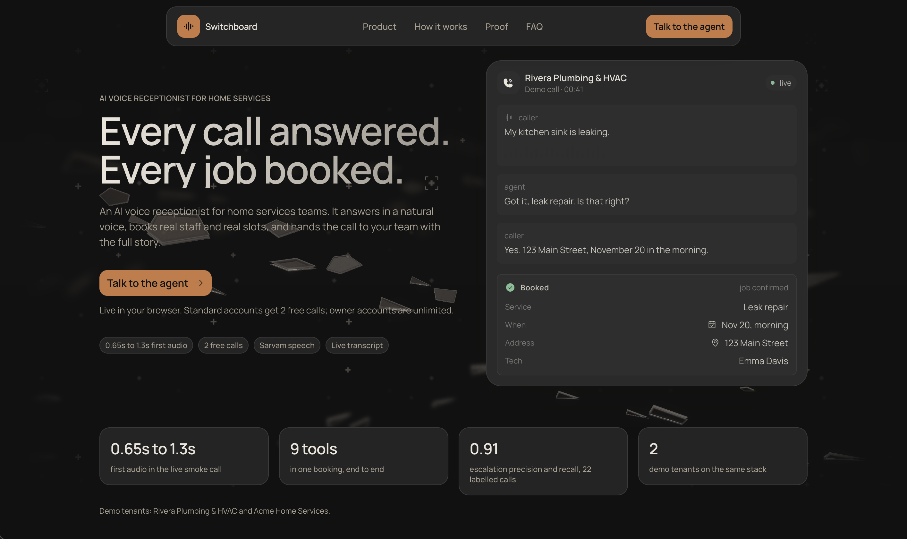
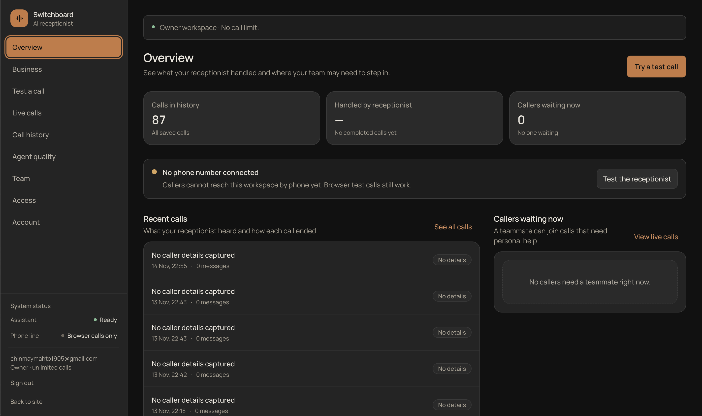
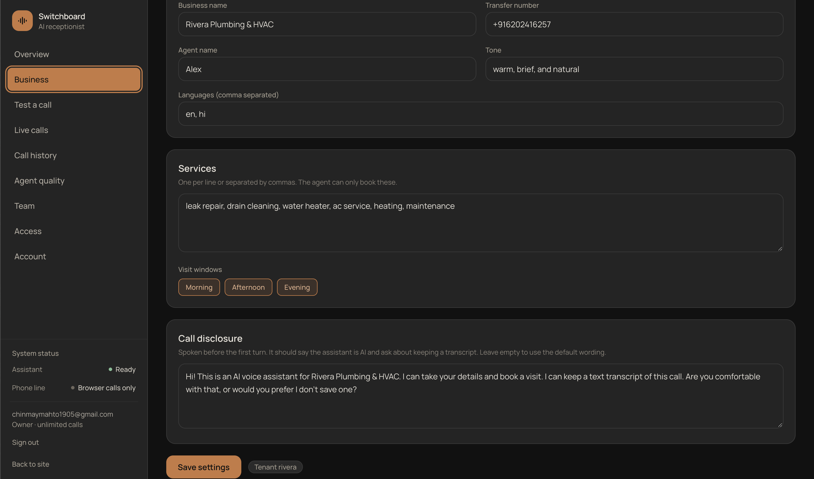
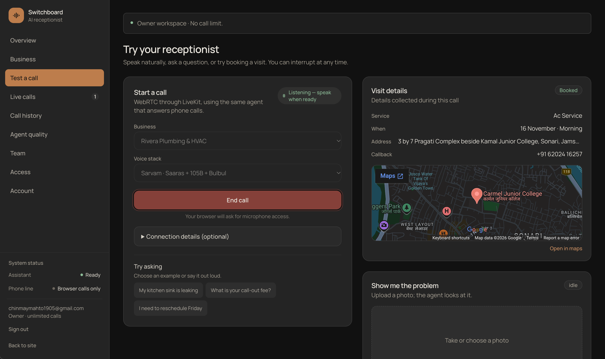

# Switchboard

[](https://github.com/chinmayyy01/switchboard/actions/workflows/ci.yml)

Switchboard is a voice receptionist for home service businesses. It answers calls, books visits from the business schedule, answers policy questions from uploaded documents, and hands a call to a teammate when the caller asks for a person. Calls can arrive through a phone number on LiveKit SIP or from the browser console.

The system has four services. A Go API owns accounts, bookings, calls, transcripts, budgets, and tenant settings. A Python agent joins the LiveKit room and runs the conversation. A Python AI service handles retrieval and vision. A Next.js app provides the landing page and the console. PostgreSQL stores the durable data. Speech, language, and voice models are configured per deployment.

## Screenshots

Landing page:



Console overview, showing call history and phone status:



Business settings for services, tone, and the transfer number:



Browser test call with the voice stack selector:



## How a call works

1. A caller joins through LiveKit SIP, or a signed in user starts a browser room from the console.
2. The agent waits for the caller, reads the SIP phone attributes when present, and asks the Go API to start the call record.
3. Streaming speech recognition transcribes the caller. Turn detection combines LiveKit's semantic detector with Silero VAD.
4. The language model calls tools to check services, save an address, check staff availability, offer a visit window, save a callback number, book, reschedule, cancel, or look up policy.
5. Policy answers come from tenant documents with citations. The agent refuses when the retrieved text does not support an answer.
6. Text to speech streams the reply. The caller can interrupt at any point.
7. On a request for a person, the agent transfers to the manager, or holds the room so a teammate can join with the transcript on screen.
8. Transcript turns are written to PostgreSQL only when the caller agreed. LiveKit webhooks close the call, and a reaper closes calls whose end event was missed.

Calls are not recorded. The agent says it is an assistant and asks whether the caller is comfortable with a saved text transcript. Declining, or not answering clearly, means no turns are stored. The call continues either way.

## What the console does

The console is a single page with these tabs:

* Overview: call counts, containment, recent calls, callers waiting, and phone status.
* Business: services, visit windows, agent name and tone, languages, disclosure text, transfer number, usage and budget, and business documents.
* Test a call: browser call with a voice stack selector for the default stack or Sarvam.
* Live calls: calls waiting for a teammate, with transcript and a join control.
* Call history: past calls, transcript, and a review control that marks whether a teammate should have joined.
* Agent quality: handoff precision and recall from the review labels, plus containment.
* Team: staff who can be assigned visits, with services, weekdays, shifts, and active status.
* Access: workspace accounts, roles, invites, and removal.
* Account: sign in details and password change.

Workspace owners can edit Business, documents, budgets, Team, and Access. Managers can use Team and day to day operations. Viewers get read access and two trial calls. The platform operator account can switch between tenants.

## Services

* `cmd/switchboard` runs the Go API on port 8090.
* `agent/` runs the LiveKit agent worker. It connects outbound to LiveKit Cloud, so it does not need a public port.
* `inference/` runs the FastAPI AI service on port 8100 for retrieval, embeddings, and vision.
* `web/` runs the Next.js app on port 3000.
* PostgreSQL stores accounts, sessions, staff, bookings, calls, turns, labels, usage, and budgets.
* Ollama provides local embeddings and the vision model.
* LiveKit Cloud carries WebRTC and SIP media.

## Repository layout

```text
agent/                 LiveKit agent worker
cmd/switchboard/       Go entry point and HTTP routes
cmd/account/           Create owners and trial accounts
cmd/migrate-auth/      Move SQLite accounts to PostgreSQL
cmd/backfill/          Import legacy JSONL calls and labels
cmd/retention/         Delete transcript turns past the retention window
cmd/eval/              Booking and escalation eval runner
cmd/sip-setup/         Write LiveKit SIP plans for the carrier
config/pricing.json    Per model price table
internal/agent/        Session types used by the eval brain
internal/booking/      Rule and LLM brains, tools, evals
internal/billing/      Usage ledger, price table, budget checks
internal/jobs/         Job store, availability, staff assignment, migrations
internal/staff/        Staff skills, days, shifts, assignments
internal/tenant/       Tenant config loader and validation
internal/api/          HTTP handlers for calls, staff, tenants, docs, budgets, agent tools
internal/calls/        Call records, turns, transcript consent, reaper
internal/livekit/      Browser and supervisor tokens, webhook verification
internal/telephony/    Provider abstraction for Plivo SIP
internal/auth/         Accounts, sessions, invites, roles, login limits
internal/inference/    AI service clients
inference/             FastAPI service, RAG, ingest, embeddings, vision
web/                   Next.js landing page and console
screenshots/           README images
tenants/               Per tenant config, documents, and staff
deploy/                Caddy, systemd units, single VM guide
deploy/observability/  Prometheus, Grafana, Jaeger
.github/workflows/     CI
```

## Run it locally

### Requirements

* Go 1.26 or newer.
* Node.js 20 or newer.
* Python 3.12. The agent packages do not support 3.15 yet.
* PostgreSQL 16 or newer.
* Ollama.
* Make.
* A LiveKit Cloud project with an API key and secret.
* A Deepgram key for speech recognition.
* A Gemini or OpenAI key for the language model.
* A Cartesia or ElevenLabs key for voice.
* Redis if you run more than one Go process. It is optional for a single process.

### 1. Configure

```bash
cp .env.example .env
```

Set the LiveKit values, at least one speech provider, one language provider, and one voice provider:

```bash
LIVEKIT_URL=wss://your-project.livekit.cloud
LIVEKIT_API_KEY=...
LIVEKIT_API_SECRET=...
DEEPGRAM_API_KEY=...
GEMINI_API_KEY=...
CARTESIA_API_KEY=...
AGENT_API_KEY=...
AGENT_TOKEN_SECRET=...
```

`AGENT_TOKEN_SECRET` must differ from `AGENT_API_KEY`. The rest of the environment is documented in `.env.example`.

### 2. Start PostgreSQL and Redis

The compose file creates a development database that matches `DATABASE_URL` in `.env.example`, plus Redis on port 6379:

```bash
docker compose -f deploy/development/postgres-compose.yml up -d
```

Set `REDIS_URL=redis://127.0.0.1:6379/0` to share call and login limits across processes. Without it, limits are kept in memory and the Go service logs a warning. Schema migrations run at startup.

### 3. Accounts, workspaces, and team access

A new business can create a workspace at `http://localhost:3000/signup`. Signup creates a tenant directory, an owner account, an empty staff list, and sends a verification email. After verification the owner lands in their workspace console.

To create an owner in an existing tenant:

```bash
go run ./cmd/account -owner -email you@example.com -password 'change-me' -tenant rivera
```

To create a teammate directly:

```bash
go run ./cmd/account -email teammate@example.com -password 'change-me' -tenant rivera -role viewer -name 'Teammate'
```

In normal use the owner invites teammates from Access. The invitee opens the emailed link, sets a name and password, verifies their email, and signs in. The roles are owner, manager, and viewer.

Without `SMTP_HOST`, invite, verification, and reset links are written to the Go log and returned by the API in development. Production requires `SMTP_HOST`.

Tenant configuration is stored under `tenants/<id>/`. A multi instance deployment needs that directory on shared storage, or a move to PostgreSQL or object storage.

A new workspace starts with generic services and an empty staff list. Add technicians in Team, then edit services, visit windows, agent name and tone, languages, disclosure, and transfer number in Business. Upload policy and FAQ files in Business under Business documents. The console saves them under `tenants/<id>/docs` and rebuilds the index. The command line path also works:

```bash
inference/.venv/bin/python inference/ingest.py --tenant <id> --docs tenants/<id>/docs
```

### 4. Install the web app and AI service

```bash
cd web
npm install
cd ..

python3.12 -m venv inference/.venv
inference/.venv/bin/pip install -r inference/requirements.txt
```

### 5. Ollama models

```bash
ollama pull nomic-embed-text
ollama pull qwen2.5vl:3b
```

`nomic-embed-text` is required for document ingest and retrieval. `qwen2.5vl:3b` is used for photo triage. The optional local answer model is `qwen3:1.7b`.

### 6. Build the knowledge base

```bash
make ingest
inference/.venv/bin/python inference/ingest.py --tenant acme --docs tenants/acme/docs
```

Ollama must be running for embeddings.

### 7. Start the services

Install the agent environment once:

```bash
make agent-install
```

Run each service in its own terminal:

```bash
make ollama
make ai
make go
make web
make agent
```

Open `http://localhost:3000` for the landing page, `http://localhost:3000/console` for the console, and `http://localhost:3000/console?tab=test` for a browser call. Allow the microphone and use headphones to avoid echo. The voice stack selector chooses the default stack or Sarvam per call.

A real phone number needs a carrier account, a DID, and applied LiveKit SIP plans. `cmd/sip-setup` writes the plans. Without them the browser console still works.

### 8. Check

```bash
make check
```

This runs the Go build, vet, tests, and the web type check. Database tests need `TEST_DATABASE_URL`.

## Protocol

LiveKit carries media. The Go and Python services exchange JSON over HTTP:

* `POST /internal/agent/session` exchanges the agent bootstrap key for a per call token, tenant configuration, and budget decision.
* `POST /internal/tools/*` accepts the per call token for booking, policy, consent, turns, usage, and escalation.
* `POST /internal/livekit/webhook` receives signed call lifecycle events.
* `GET /api/calls/live` and `GET /api/calls/{id}/supervisor-token` support the supervisor handoff.
* `GET /api/tenant/docs`, `POST /api/tenant/docs`, `DELETE /api/tenant/docs`, and `POST /api/tenant/docs/reindex` manage tenant documents.
* `GET /api/budget` and `PATCH /api/budget` read and set the monthly usage cap.

The console receives live transcripts on the `lk.transcription` topic and product events on `switchboard.events`.

## Staff and availability

Staff are seeded from `tenants/<id>/staff.json` the first time a tenant is initialized. After that, manage them in Team. Each employee has a work role, contact details, services, weekdays, shifts, and an active flag. Only active technicians with a matching service can be assigned a visit. Work roles do not grant console access.

Bookings, assignments, cancellations, and reschedules are stored in PostgreSQL. Booking transactions lock the schedule and use an idempotency key, so a retry returns the original visit instead of creating a duplicate. This is Switchboard's own job store, not an external calendar or dispatch system.

## Transcripts and retention

Transcript turns are stored only when the call has transcript consent. The check is inside the INSERT statement, so an agent bug cannot bypass it. `make retention` deletes turns older than `TRANSCRIPT_RETENTION_DAYS`, which defaults to 180 days. Call records and consent evidence remain after the turns are deleted.

## Tenants

Each tenant has a configuration file, documents, and staff:

```text
tenants/rivera/
  config.json
  docs/
  staff.json
tenants/acme/
  config.json
  docs/
  staff.json
```

## Evaluation

`make eval` runs the booking, handoff, and retrieval suites:

* Booking: 5 of 5 scripted scenarios.
* Handoff: precision 0.909 and recall 0.909 on 22 authored scenarios.
* Retrieval: recall at 1 and at 3 is 1.00, with MRR 1.00 on 18 questions.
* Grounding: 0.944 grounded and 0.833 abstention on 18 questions.

The handoff numbers come from authored scenarios, not a labelled set of real calls. The console's Agent quality tab uses review labels from actual calls once they exist.

## Configuration

The full list is in `.env.example`. The main groups:

* Core: `APP_ENV`, `APP_ORIGIN`, `APP_BASE_URL`, `SESSION_TTL`, `COOKIE_SECURE`, `TRUSTED_PROXIES`.
* Database: `DATABASE_URL`, `TEST_DATABASE_URL`, `REDIS_URL`, `AUTH_DRIVER`, `AUTH_DB`.
* LiveKit: `LIVEKIT_URL`, `LIVEKIT_API_KEY`, `LIVEKIT_API_SECRET`, `LIVEKIT_AGENT_NAME`, `AGENT_API_KEY`, `AGENT_TOKEN_SECRET`.
* Speech and language: `DEEPGRAM_API_KEY`, `STT_MODEL`, `STT_FALLBACK_MODEL`, `STT_LANGUAGE`, `STT_ENDPOINTING_MS`, `GEMINI_API_KEY`, `GEMINI_MODEL`, `OPENAI_API_KEY`, `OPENAI_MODEL`, `OPENAI_FALLBACK_MODEL`, `CARTESIA_API_KEY`, `ELEVEN_API_KEY`.
* Sarvam: `SARVAM_API_KEY`, `SARVAM_MODEL`, `SARVAM_STT_MODEL`, `SARVAM_TTS_MODEL`, `SARVAM_TTS_SPEAKER`.
* Retrieval and vision: `INFERENCE_URL`, `OLLAMA_URL`, `OLLAMA_MODEL`, `EMBED_MODEL`, `VISION_MODEL`, `KNOWLEDGE_DIR`.
* Email: `SMTP_HOST`, `SMTP_PORT`, `SMTP_USER`, `SMTP_PASSWORD`, `SMTP_FROM`.
* Budget and limits: `PRICING_FILE`, `DEFAULT_MONTHLY_CAP_MINOR`, `BUDGET_ACTION`, `MAX_CALL_SECONDS`, `TRANSCRIPT_RETENTION_DAYS`.
* Web: `NEXT_PUBLIC_API_URL`, `NEXT_PUBLIC_AI_URL`, `NEXT_PUBLIC_SITE_URL`, `NEXT_PUBLIC_AUTH_DISABLED`.

Accounts and sessions live in PostgreSQL. The owner account has no call limit. Other accounts have a two call lifetime quota and one active call at a time. `AUTH_DISABLED=true` is ignored outside development unless `ALLOW_DEV_AUTH=true` is set; production always requires authentication.

## Commands

* `make ollama`: start Ollama if it is not running.
* `make ai`: run the Python AI service on port 8100.
* `make go`: run the Go API on port 8090.
* `make web`: run the Next.js app on port 3000.
* `make agent`: run the LiveKit agent worker in development mode.
* `make agent-install`: create the agent virtual environment and install dependencies.
* `make ingest`: build the Rivera knowledge index.
* `make eval`: run the booking, handoff, and retrieval suites.
* `make sip-plan`: write LiveKit SIP plans for Plivo.
* `make retention`: delete transcript turns past the retention window.
* `make backfill`: import legacy `data/calls.jsonl` metadata and labels.
* `make check`: run the Go build, vet, tests, and web type check.

Observability is optional:

```bash
docker compose -f deploy/observability/docker-compose.yml up -d
```

Prometheus runs on port 9090, Grafana on 3001, and Jaeger on 16686.
