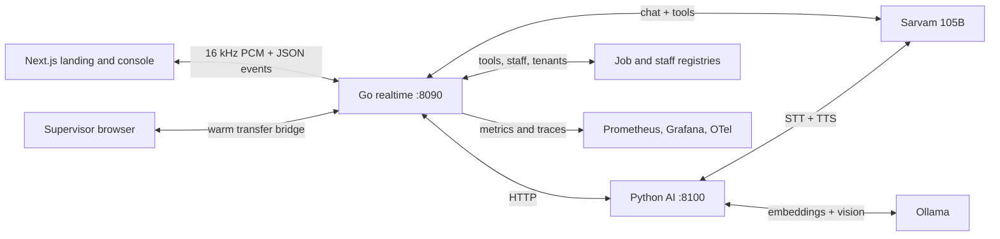

# Switchboard

[](https://github.com/chinmayyy01/switchboard/actions/workflows/ci.yml)

**An AI voice receptionist for home services.**

Switchboard answers the phone, books real visits against staff availability, answers policy from tenant documents, and hands the call to a supervisor with the full transcript. It runs on a Go realtime service, a Python AI service, a Next.js console, and Sarvam speech and language models.


> **Status:** portfolio demo snapshot.
> Browser only. No telephony, recordings, or production data.
> Auth is temporarily disabled in the local preview with `AUTH_DISABLED=true`; the owner/trial policy remains in code and can be re-enabled.
> Jobs and staff live in memory and reset on restart.
> Production hardening is tracked separately from this demo snapshot.

## Contents

- [What it does](#what-it-does)
- [Case study](docs/case-study.md)
- [Screenshots](#screenshots)
- [Quick start](#quick-start)
- [Architecture](#architecture)
- [Measurements](#measurements)
- [Configuration](#configuration)
- [Commands](#commands)
- [Project layout](#project-layout)
- [Limitations](#limitations)
- [Production readiness](#production-readiness)
- [Deployment](deploy/README.md)
- [Credits](#credits)

## What it does

- **Natural voice calls.** Sarvam Bulbul at 22.05 kHz, sentence by sentence TTS, barge in, and short backchannels such as "mm-hmm" and "okay".
- **Real bookings.** The agent calls tools to check availability, assign a technician by skill and shift, and read back the details before booking.
- **Alternatives when full.** If no technician is available, the tool returns specific dates and windows and the agent asks the caller to choose.
- **Grounded policy.** Hours, pricing, warranty, and service area are answered from tenant documents with citations; it refuses when the answer is not grounded.
- **Warm handoff.** Emergencies and human requests hold the call live for a supervisor instead of hanging up. The supervisor joins a browser audio bridge with the transcript.
- **Photo triage.** A caller can upload a photo; local vision (`qwen2.5vl`) writes a short description into the conversation.
- **Tenant aware.** Services, docs, staff, and the console are separated per tenant.
- **Measured.** Escalation, booking, retrieval, latency, and usage metrics are collected and scored.

## Screenshots

### Landing


### Console


### Test call


### Measured call


## Quick start

### Requirements

- Go 1.26+
- Node.js 20+
- Python 3.12
- Ollama
- Make
- A Sarvam API key, recommended
- Optional: OpenAI or Deepgram keys

### 1. Environment

```bash
cp .env.example .env
```

Set at least:

```bash
SARVAM_API_KEY=sk_...
```

The example environment sets `AUTH_DISABLED=false`. This local preview sets `AUTH_DISABLED=true` in `.env`, so the console opens without sign-in. Set it back to `false` to use accounts again.

Without a key, set `STT_PROVIDER=local` and `TTS_PROVIDER=piper` to use Whisper and Piper, and the brain falls back to the hybrid rule state machine. The intended demo path is Sarvam for speech and chat, with Ollama for embeddings and vision.

### 2. Accounts for when auth is enabled

```bash
go run ./cmd/account -owner -email you@example.com -password 'change-me' -tenant rivera
```

`-prune` deletes every non-owner account and session. Create a standard account with 2 free calls:

```bash
go run ./cmd/account -email teammate@example.com -password 'change-me' -tenant rivera
```

The owner can use every tenant and has no call limit. Every other account is limited to 2 total calls and one active call at a time. These steps are only needed when `AUTH_DISABLED=false`.

### 3. Install the web app

```bash
cd web
npm install
cd ..
```

### 4. Install the AI service

```bash
python3.12 -m venv inference/.venv
inference/.venv/bin/pip install -r inference/requirements.txt
```

### 5. Ollama models

```bash
ollama pull nomic-embed-text
ollama pull qwen2.5vl:3b
```

Optional, for the local fallback and the experimental LLM brain:

```bash
ollama pull qwen3:1.7b
```

### 6. Piper voice for the local fallback

The voice files are not committed. Download a Piper medium voice and point `PIPER_VOICE` at it:

```bash
mkdir -p inference/voices
curl -L -o inference/voices/en_US-lessac-medium.onnx \
  https://huggingface.co/rhasspy/piper-voices/resolve/main/en/en_US/lessac/medium/en_US-lessac-medium.onnx
curl -L -o inference/voices/en_US-lessac-medium.onnx.json \
  https://huggingface.co/rhasspy/piper-voices/resolve/main/en/en_US/lessac/medium/en_US-lessac-medium.onnx.json
```

```bash
PIPER_VOICE=/absolute/path/to/en_US-lessac-medium.onnx
TTS_RATE=22050
```

### 7. Build the knowledge base

```bash
make ingest
inference/.venv/bin/python inference/ingest.py --tenant acme --docs tenants/acme/docs
```

Ollama must be running for embeddings.

### 8. Run

In separate terminals:

```bash
make ollama
make ai
make go
make web
```

Open:

- Landing: http://localhost:3000
- Console: http://localhost:3000/console
- Test call: http://localhost:3000/console?tab=test
- Sign in, when auth is enabled: http://localhost:3000/login

With auth disabled, open the console and start a call. With auth enabled, sign in with the owner or a trial account. Allow the microphone, use headphones, and press **Start call**. The AI service loads Whisper and Piper at startup; a local model downloads on first run if it is not cached.

### 9. Check

```bash
make check
```

Runs Go build, vet, and tests plus the web type check.

## Architecture



### Call flow

1. The browser streams 16 kHz mono PCM in 20 ms frames.
2. Energy VAD with a 300 ms pre-roll finds the end of the caller's turn.
3. The AI service transcribes the utterance with Sarvam Saaras, Deepgram, or local Whisper.
4. The brain runs with tools: check service, save address, check staff availability, set a window, save a phone number, book, reschedule, cancel, or look up policy.
5. Policy questions are retrieved from tenant documents, answered with citations, and refused when ungrounded.
6. The reply is split into sentences and synthesized as it is produced.
7. On escalation, the call is held and flagged; a supervisor can join the live bridge.
8. The transcript, outcome, signal, and label are stored locally.

### Protocol

One WebSocket per call.

- Binary frames: 16 kHz mono Int16 PCM, 320 samples per 20 ms frame.
- Text frames: JSON control and events such as `call.start`, `interrupt`, `stt.final`, `agent.text`, `tool.call`, `agent.speaking`, `agent.done`, `latency`, `escalation`, and `call.end`.
- TTS is returned at 22.05 kHz and played at its native rate.

### Staff and availability

Staff are defined in `tenants/<id>/staff.json` with skills, weekdays, and shifts. Availability is computed per service, date, and window. Booking assigns a technician and marks the slot busy; cancel and reschedule release or move it. When nobody is available, the tools return alternatives instead of inventing a slot.

### Tenants

Each tenant has a config, documents, and staff:

```text
tenants/rivera/
  config.json
  docs/
  staff.json
tenants/acme/
  config.json
  docs/
  staff.json
```

## Measurements

Measured on this Mac on the live demo. These are demo numbers, not a benchmark.

| Area | Result |
| --- | --- |
| Booking | 5 of 5 scripted scenarios; live Sarvam smoke call booked end to end |
| Escalation | precision 0.909, recall 0.909 on 22 labelled calls |
| Retrieval | recall@1 1.00, recall@3 1.00, MRR 1.00 on 18 questions |
| Grounding | grounded 0.944, abstention 0.833 on 18 questions |
| First audio | 0.65 s to 1.3 s server side on the Sarvam smoke call |
| Local fallback p95 | 1.50 s at 5 calls, 2.83 s at 10 calls, Whisper base and Piper on CPU |
| Load | 500 fake callers, 0 failures, p95 around 10 ms with fake providers |
| Usage per 9 turn call | about 20.8k prompt tokens, 415 completion tokens, 920 TTS characters, 24.7 s STT |

Cost depends on current Sarvam rates. Usage is measured; a rupee cost is not calculated in this demo.

## Configuration

| Variable | Purpose | Default |
| --- | --- | --- |
| `SARVAM_API_KEY` | Sarvam STT, TTS, and chat | empty |
| `SARVAM_MODEL` | Chat model | `sarvam-105b-conversations` |
| `SARVAM_STT_MODEL` | Speech to text model | `saaras:v4` |
| `SARVAM_TTS_MODEL` | Text to speech model | `bulbul:v3` |
| `SARVAM_TTS_SPEAKER` | Voice | `shubh` |
| `STT_PROVIDER` | `sarvam`, `deepgram`, or `local` | `sarvam` |
| `TTS_PROVIDER` | `sarvam` or `piper` | `sarvam` |
| `DEEPGRAM_API_KEY` | Optional streaming grade STT | empty |
| `WHISPER_MODEL` | Local Whisper model | `base` |
| `PIPER_VOICE` | Absolute path to a Piper voice | required for Piper |
| `TTS_RATE` | Playback sample rate | `22050` |
| `OPENAI_API_KEY` | Optional full LLM brain | empty |
| `BRAIN` | Local brain mode | `hybrid` |
| `OLLAMA_URL` | Ollama endpoint | `http://localhost:11434` |
| `OLLAMA_MODEL` | Local fallback model | `qwen3:1.7b` |
| `VISION_MODEL` | Local vision model | `qwen2.5vl:3b` |
| `INFERENCE_URL` | Python AI service | `http://127.0.0.1:8100` |
| `NEXT_PUBLIC_WS_URL` | Realtime WebSocket | `ws://localhost:8090/ws` |
| `NEXT_PUBLIC_API_URL` | Go API | `http://localhost:8090` |
| `NEXT_PUBLIC_AI_URL` | Python AI | `http://127.0.0.1:8100` |
| `NEXT_PUBLIC_SITE_URL` | Canonical and social metadata | `http://localhost:3000` |
| `AUTH_DB` | SQLite accounts and sessions | `data/auth.db` |
| `AUTH_DISABLED` | Bypass login and use a local owner account | `false` |
| `DEV_TENANT` | Tenant used by the local owner when auth is disabled | `rivera` |
| `NEXT_PUBLIC_AUTH_DISABLED` | Show the local-preview banner and copy | `false` |
| `APP_ORIGIN` | Allowed browser origin for cookies and CORS | `http://localhost:3000,http://127.0.0.1:3000` |
| `SESSION_TTL` | Session lifetime | `12h` |
| `COOKIE_SECURE` | Require HTTPS cookies | `false` |
| `KNOWLEDGE_DIR` | Ingested knowledge directory | `data/knowledge` |
| `OTEL_EXPORTER_OTLP_ENDPOINT` | Optional OTLP endpoint | empty |
| `CHAT_MODEL_LARGE` | Optional larger model route | empty |

Accounts and sessions live in SQLite. The owner account is unlimited; other accounts have a 2-call lifetime quota and one active call at a time. While `AUTH_DISABLED=true`, every request uses a local unlimited owner account, so the quota is bypassed.

The LLM brain selection is automatic: Sarvam if `SARVAM_API_KEY` is set, then OpenAI if `OPENAI_API_KEY` is set, then Ollama via `BRAIN=llm` or the hybrid rule brain.

## Commands

| Command | What it does |
| --- | --- |
| `make ollama` | Start Ollama if it is not already running |
| `make ai` | Python AI service on `:8100` |
| `make go` | Go realtime service on `:8090` |
| `make web` | Next.js landing and console on `:3000` |
| `make ingest` | Ingest Rivera docs into `data/knowledge` |
| `make eval` | Booking, escalation, and RAG evals |
| `make smoke` | Live Sarvam call that asserts a booking; needs `SMOKE_EMAIL` and `SMOKE_PASSWORD` |
| `make load` | 50 concurrent fake callers; needs `LOAD_EMAIL` and `LOAD_PASSWORD` |
| `make check` | Go build, vet, tests, and web type check |

`make smoke` uses real Sarvam credits. It signs in with `SMOKE_EMAIL` and `SMOKE_PASSWORD`, defaults to the `acme` tenant, and picks a random future date. Use the owner account: standard accounts are limited to 2 calls.

```bash
SMOKE_EMAIL=you@example.com SMOKE_PASSWORD='...' make smoke
LOAD_EMAIL=you@example.com LOAD_PASSWORD='...' make load
```

Restart `make go` first for a clean in-memory job store.

Optional observability:

```bash
docker compose -f deploy/observability/docker-compose.yml up -d
```

Prometheus runs on `:9090`, Grafana on `:3001`, and Jaeger on `:16686`. This stack is not required for the demo.

## Project layout

```text
cmd/switchboard/       Go entry point and HTTP routes
cmd/account/           Create the owner or trial accounts
cmd/eval/              Booking and escalation eval runner
cmd/loadgen/           Fake concurrent callers
internal/agent/        Session, VAD, brains, providers
internal/booking/      Rule and LLM brains, tools, evals
internal/jobs/         Job store, availability, staff assignment
internal/staff/        Staff skills, days, shifts, assignments
internal/tenant/       Tenant config loader
internal/ws/           WebSocket handler, hub feed, audio bridge
internal/api/          Calls, labels, report, staff, geocode
internal/auth/         Accounts, sessions, quotas, login
internal/store/        Call records and summaries
internal/inference/    AI service clients
inference/             FastAPI AI service, RAG, caching, TTS, STT, evals
web/                   Next.js landing and single page console
tenants/               Per tenant config, docs, and staff
scripts/               Live smoke test
docs/screenshots/      README screenshots
docs/case-study.md     Portfolio write-up
deploy/                Caddy, systemd, and single-VM guide
deploy/observability/  Prometheus, Grafana, Jaeger
.github/workflows/     CI
```

## Limitations

- **Browser only.** No inbound numbers, SIP, Twilio, Telnyx, or outbound campaigns.
- **Auth is disabled in the local preview.** `AUTH_DISABLED=true` bypasses login and quota; do not deploy with it enabled. When enabled, accounts are invite-only, with no public signup, password reset, or email verification. Standard accounts get 2 lifetime calls; the owner is unlimited.
- **In memory.** Jobs and staff reset on restart; call records are appended to `data/calls.jsonl`.
- **No recordings.** Transcripts are kept; audio is not.
- **No cost caps.** Usage is measured; hard budgets are not enforced.
- **Single node.** No Redis, Postgres, queue, or automatic failover. The one-call limiter is per process, so multiple Go instances would each allow a call.
- **Sarvam dependency.** Speech and chat quality and latency depend on the Sarvam API.
- **Demo data.** Staff, tenants, addresses, and calls are fictional.
- **Not for emergencies.** Do not point a real emergency line at this demo.
- **WebGPU.** The landing shards need WebGPU; without it the hero falls back to a flat background.

## Production readiness

This branch is a demo. Before a real phone product:

- [ ] Inbound DIDs and SIP or WebRTC media.
- [ ] Real transfer with ring groups, paging, hold timeout, and fallback.
- [ ] Public signup, email verification, password reset, RBAC, and distributed quotas.
- [ ] Postgres, Redis, and object storage.
- [ ] Call recordings with consent and retention.
- [ ] Cost metering, per-tenant budgets, and hard caps.
- [ ] SLOs, alerts, on call, and incident runbooks.
- [ ] Compliance: consent, recording disclosure, DPDP, and GDPR.

Production hardening is tracked separately; `main` stays as the portfolio demo snapshot.

## Portfolio

- [Case study](docs/case-study.md): problem, decisions, measured results, tradeoffs.
- [Deployment guide](deploy/README.md): single VM with Caddy, systemd, and Ollama.
- [CI](.github/workflows/ci.yml): Go build/vet/race tests, web typecheck/build, Python compile.
- Live KPI dashboard: the console Overview, plus the Grafana dashboard in `deploy/observability`.

## Credits

- [Sarvam AI](https://www.sarvam.ai) for Saaras, Bulbul, and Sarvam 105B.
- [React Bits Aero Shards](https://www.reactbits.dev/backgrounds/aero-shards) for the hero background, MIT licensed.
- [Phosphor Icons](https://phosphoricons.com) for the console and landing icons.
- [Manrope](https://fonts.google.com/specimen/Manrope) and [Geist Mono](https://fonts.google.com/specimen/Geist+Mono) through `next/font`.
- Go, Next.js, FastAPI, and Ollama.
