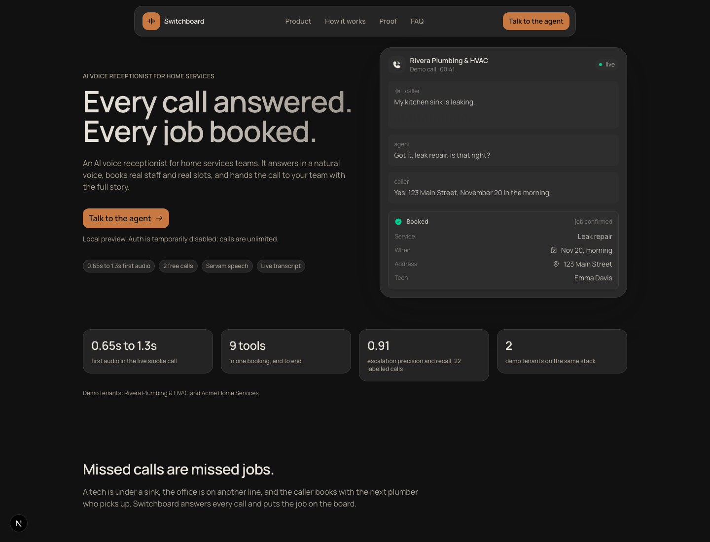
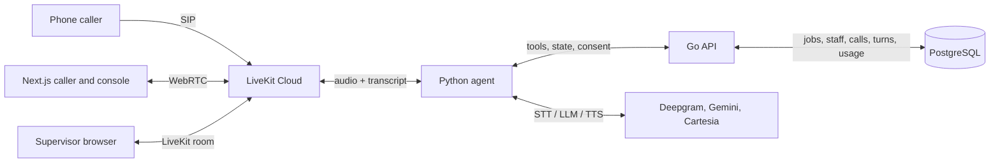

# Switchboard: an AI voice receptionist for home services

A working browser and SIP voice agent that answers a call, books a real visit
against staff availability, answers policy from tenant documents, and hands the
line to a human when the call needs one.

This is the portfolio case study. The runnable project is in the repository
root: see [README](../README.md).

## The problem

A small home services office misses calls while technicians are on site. The
caller either leaves a voicemail or calls the next company. When the office does
call back, the slot may already be gone.

A useful receptionist has to do more than transcribe speech. It has to:

- understand the service, address, time, and callback number;
- check whether a qualified technician is actually available;
- book, move, or cancel the visit;
- answer policy questions without inventing an answer;
- hand the call to a person with the full context.

## What I built

A caller reaches a LiveKit room over SIP or from the browser console. A Python
agent handles speech and model calls; Go owns tools, consent, pricing, and
persistence. The console shows the live transcript, booking card, latency, KPIs,
and supervisor handoff. The same agent answers phone and browser calls.

### Conversation

- Deepgram for streaming speech to text, with a fallback model.
- Gemini or OpenAI with tool calling for the booking flow, behind a fallback adapter.
- Cartesia or ElevenLabs for streaming TTS, with barge-in.
- LiveKit's semantic turn detector plus Silero VAD.
- Hindi and English.

### Booking

The model proposes tools. Go validates every action.

- `set_service`, `save_address`, `set_time`, `set_phone`
- `check_availability`
- `book`, `lookup_job`, `reschedule`, `cancel`
- `lookup_policy`, `transfer_to_human`

The job store assigns a technician by skill, weekday, and shift. When a window
is full, the tools return specific alternatives rather than a vague apology.
Cancelling or rescheduling releases the assigned slot.

### Knowledge and guardrails

Tenant documents are chunked and embedded with Ollama. Policy answers are
retrieved, answered with citations, and refused when the context is not
grounded. The guard layer catches prompt injection, PII, out-of-scope requests,
and unsafe actions before tools run.

### Human handoff

An emergency or a request for a person does not hang up. The call is held,
flagged in the console, and the supervisor can join a live audio bridge with the
transcript already on screen.

### Console and KPIs

The console is the operations view:

- live calls and escalations;
- containment, escalation precision, and recall;
- booking card and transcript;
- first-audio, STT, brain, TTS, and turn latency per turn;
- calls, labels, team, and photo triage.

Prometheus, Grafana, and Jaeger configs are in `deploy/observability`.

## Decisions and tradeoffs

**LiveKit for media, Go for effects, Python for models.** LiveKit owns transport,
rooms, SIP, and turn detection. Go owns pricing, consent, booking, and every
side effect. Python owns speech and model calls. The split keeps credentials and
business state out of the model process and lets each side be tested alone.

**The model proposes, code verifies.** The LLM does not write directly to the
job store. A hallucinated slot is rejected; a full slot returns alternatives;
the booking requires a signed confirmation token after a read-back.

**Two consents, not one.** Audio recording and transcript storage are separate
choices with a versioned disclosure. Declining audio does not block service, and
the consent check lives inside the SQL insert, not in the prompt.

**Postgres for call truth.** Calls, turns, labels, recordings, usage, accounts,
and sessions live in PostgreSQL. LiveKit webhooks are authoritative for call
end; a reaper closes anything missed.

**Recording is opt-in and short-lived.** Egress starts only after an explicit
yes, stores an object key, and is deleted after 30 days. Playback is a
presigned URL; the bucket is private.

**Budgets are enforced, not dashboarded.** A per-tenant ledger and price table
feed a pre-call check. At the cap the agent transfers to a human; a hard call
duration stops runaway calls.

## Measured results

Measured on a Mac against the local stack. The table below is from the earlier
browser pipeline; the LiveKit phone path has not been measured against a real
carrier yet. These are demo numbers, not a benchmark.

| Area | Result |
| --- | --- |
| Booking | 5 of 5 scripted scenarios; one prior live Sarvam smoke booking (requires API credentials/credits) |
| Live smoke | One recorded run: 9 tools, booked with a named technician, no escalation |
| Escalation | precision 0.909, recall 0.909 on 22 hand-authored scenarios; not a labeled real-call sample |
| Retrieval | recall@1 1.00, recall@3 1.00, MRR 1.00 on 18 questions |
| Grounding | grounded 0.944, abstention 0.833 on 18 questions |
| First audio | 0.65 s to 1.3 s on the earlier live smoke; 0.84 s to 3.9 s in the latest run |
| Local fallback | p95 1.50 s at 5 calls, 2.83 s at 10 calls on CPU Whisper and Piper |
| Usage per 9-turn call | about 23k prompt tokens, 396 completion tokens |

These are one-off local demo measurements, not a reproducible benchmark. The
current repository includes the 22-case escalation suite and an 18-question RAG
suite, but no labeled real-call set or archived performance report. Prior smoke
runs reached 6.6 s STT and 4.8 s TTS; those provider-dependent measurements need
to be rerun before being treated as current performance evidence.

## What I would build next

1. Provision an Indian DID and complete carrier KYC, then run the real-call gate.
2. Route alerts through Alertmanager with on-call and an incident runbook.
3. SSO, billing, and enterprise identity.
4. SMS confirmation and reminders after a booking.
5. Label real calls and replace authored-scenario quality scores.
6. A speech-to-speech model experiment against the 1.2 s p50 SLO.

## Links

- [README and setup](../README.md)
- [Landing screenshot](screenshots/landing.png)
- [Console screenshot](screenshots/console.png)
- [Test call screenshot](screenshots/test-call.png)
- [Measured booking](screenshots/proof.png)
- [Local observability](../deploy/observability/README.md)
