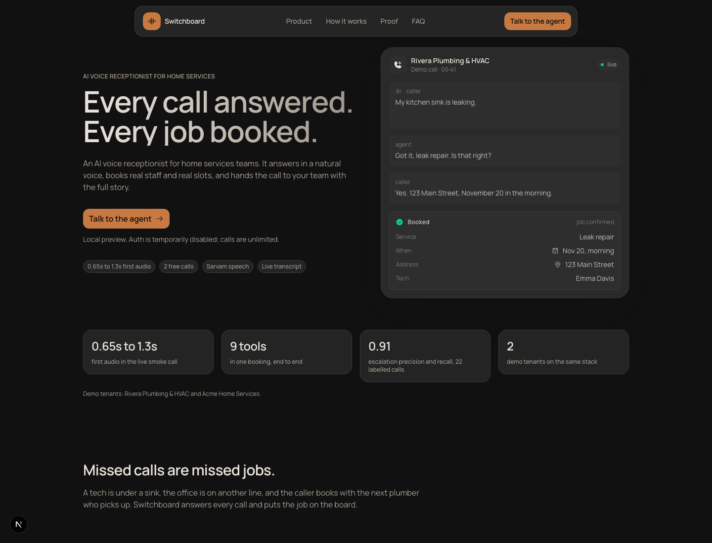
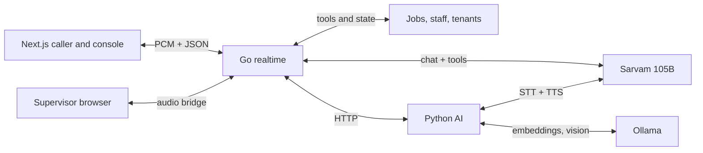

# Switchboard: an AI voice receptionist for home services

A working browser-based voice agent that answers a call, books a real visit
against staff availability, answers policy from tenant documents, and holds the
line for a human when the call needs one.

This is the portfolio case study. The runnable project is in the repository
root: see [README](../README.md).

## The problem

A small home services office misses calls while technicians are on site. The
caller either leaves a voicemail or calls the next company. When the office does
call back, the slot may already be gone.

A useful receptionist has to do more than transcribe speech. It has to:

- understand the service, address, time, and callback number;
- check whether a qualified technician is actually available;
- book, move, or cancel the visit;
- answer policy questions without inventing an answer;
- hand the call to a person with the full context.

## What I built

A browser caller talks to a Go realtime service. Audio is streamed as 16 kHz
mono PCM in 20 ms frames. The Go service runs energy VAD and the conversation
state; the Python service handles Sarvam speech and retrieval; the browser
console shows the live transcript, booking card, latency, KPIs, and supervisor
handoff.

### Conversation

- Sarvam Saaras v4 for speech to text, with Deepgram and local Whisper fallbacks.
- Sarvam 105B with tool calling for the booking flow.
- Sarvam Bulbul v3 at 22.05 kHz, sentence by sentence, with barge in.
- Short backchannels while the brain thinks.
- Hindi and English.

### Booking

The model proposes tools. Go validates every action.

- `set_service`, `save_address`, `set_time`, `set_phone`
- `check_availability`
- `book`, `lookup_job`, `reschedule`, `cancel`
- `lookup_policy`, `transfer_to_human`

The job store assigns a technician by skill, weekday, and shift. When a window
is full, the tools return specific alternatives rather than a vague apology.
Cancelling or rescheduling releases the assigned slot.

### Knowledge and guardrails

Tenant documents are chunked and embedded with Ollama. Policy answers are
retrieved, answered with citations, and refused when the context is not
grounded. The guard layer catches prompt injection, PII, out-of-scope requests,
and unsafe actions before tools run.

### Human handoff

An emergency or a request for a person does not hang up. The call is held,
flagged in the console, and the supervisor can join a live audio bridge with the
transcript already on screen.

### Console and KPIs

The console is the operations view:

- live calls and escalations;
- containment, escalation precision, and recall;
- booking card and transcript;
- first-audio, STT, brain, TTS, and turn latency per turn;
- calls, labels, team, and photo triage.

Prometheus, Grafana, and Jaeger configs are in `deploy/observability`.

## Decisions and tradeoffs

**Go for realtime, Python for models.** Go owns the socket, VAD, state, tools,
and policy. Python owns speech, retrieval, and vision. The split keeps audio
latency work away from Python model startup and lets each side be tested alone.

**Server-side VAD.** Browser VAD was inconsistent across microphones. Energy
VAD with a 300 ms pre-roll and a 600 ms hangover made turns predictable.

**Streamed sentence TTS.** Waiting for a full reply before speaking felt slow.
Streaming sentence by sentence brought first audio below a second on the live
Sarvam path, at the cost of more TTS requests.

**Code validates every tool action.** The LLM does not write directly to the job
store. A hallucinated slot is rejected; a full slot returns alternatives.

**Fake staff, real constraints.** Staff skills, weekdays, shifts, and busy slots
are real enough to exercise assignment and release. Tenant data is fictional.

**Auth is disabled for the local preview.** The owner and 2-call trial code is
present, but the running preview uses `AUTH_DISABLED=true` so it can be opened
without a login. This must be off before a public deployment.

**Separate durable business data from demo transcripts.** Jobs and staff persist
in PostgreSQL. Call records append to `data/calls.jsonl`; review labels live in
`data/labels.json`.

## Measured results

Measured on a Mac against the local stack. These are demo numbers, not a
benchmark.

| Area | Result |
| --- | --- |
| Booking | 5 of 5 scripted scenarios; one prior live Sarvam smoke booking (requires API credentials/credits) |
| Live smoke | One recorded run: 9 tools, booked with a named technician, no escalation |
| Escalation | precision 0.909, recall 0.909 on 22 hand-authored scenarios; not a labeled real-call sample |
| Retrieval | recall@1 1.00, recall@3 1.00, MRR 1.00 on 18 questions |
| Grounding | grounded 0.944, abstention 0.833 on 18 questions |
| First audio | 0.65 s to 1.3 s on the earlier live smoke; 0.84 s to 3.9 s in the latest run |
| Local fallback | p95 1.50 s at 5 calls, 2.83 s at 10 calls on CPU Whisper and Piper |
| Load | `make load` runs 50 synthetic callers; the older 500-caller result has no checked-in report |
| Usage per 9-turn call | about 23k prompt tokens, 396 completion tokens |

These are one-off local demo measurements, not a reproducible benchmark. The
current repository includes the 22-case escalation suite and an 18-question RAG
suite, but no labeled real-call set or archived performance report. Prior smoke
runs reached 6.6 s STT and 4.8 s TTS; those provider-dependent measurements need
to be rerun before being treated as current performance evidence.

## What I would build next

1. Telephony: choose a provider and region, add inbound numbers, and bridge
   provider audio into the existing realtime call flow.
2. Phone handoff: transfer to a real teammate with ring timeout and fallback.
3. Onboarding and access control: connect a business, manage account roles, and
   configure consent and data retention.
4. SMS confirmation and reminders after a booking.
5. Per-tenant cost budgets, latency SLOs, alerts, and an incident runbook.

## Links

- [README and setup](../README.md)
- [Landing screenshot](screenshots/landing.png)
- [Console screenshot](screenshots/console.png)
- [Test call screenshot](screenshots/test-call.png)
- [Measured booking](screenshots/proof.png)
- [Local observability](../deploy/observability/README.md)
